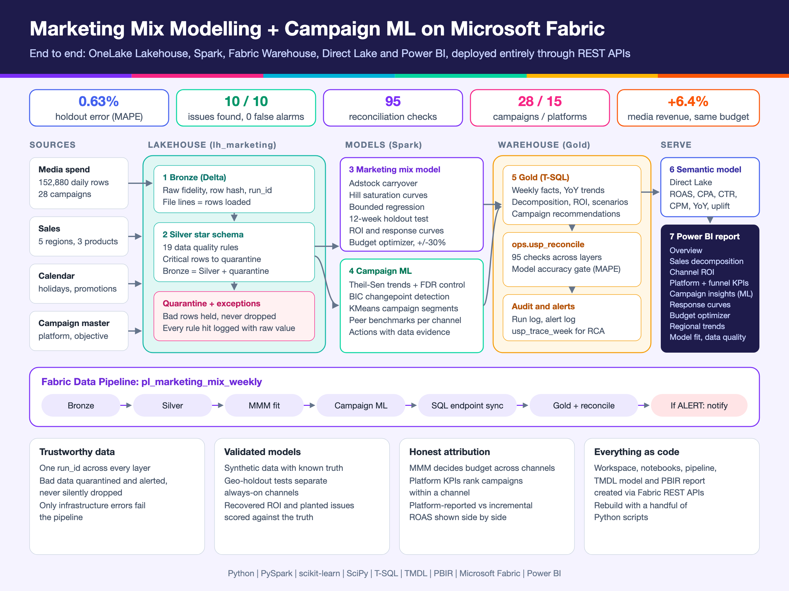
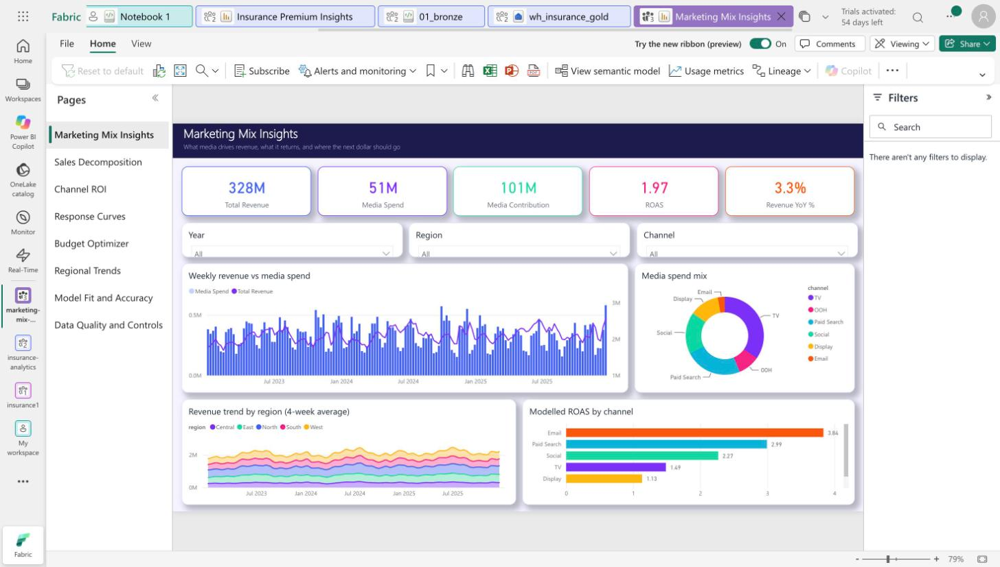
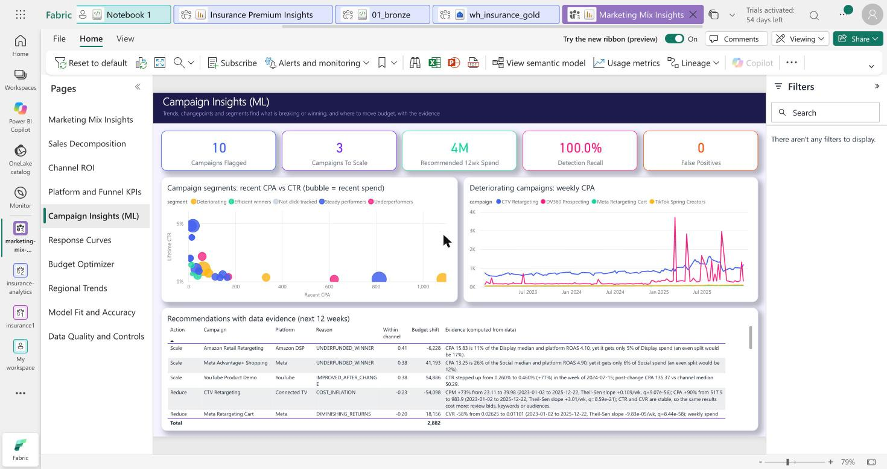
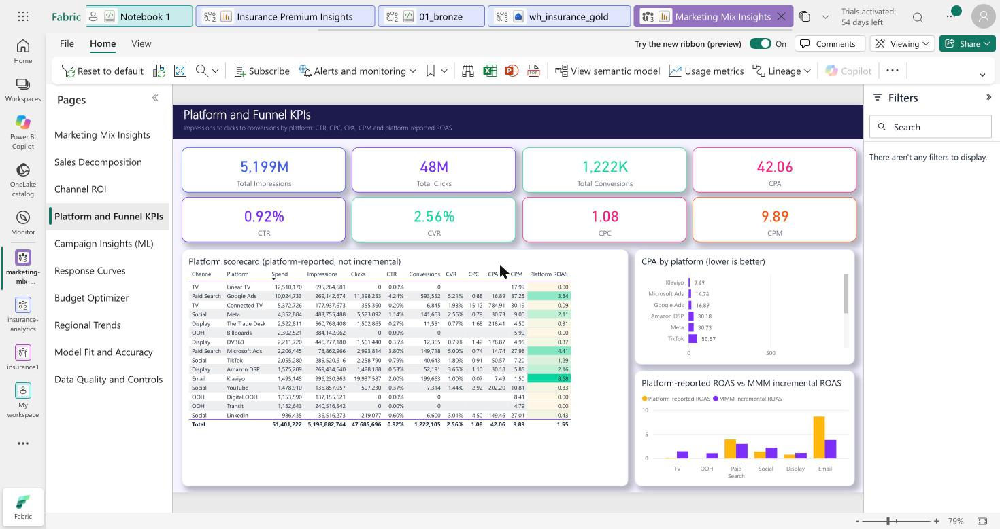
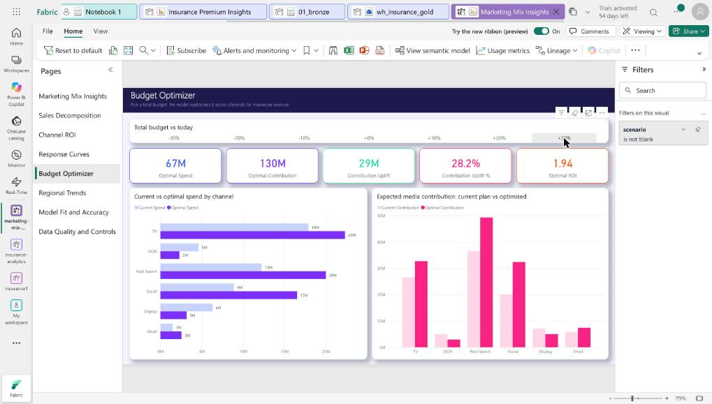
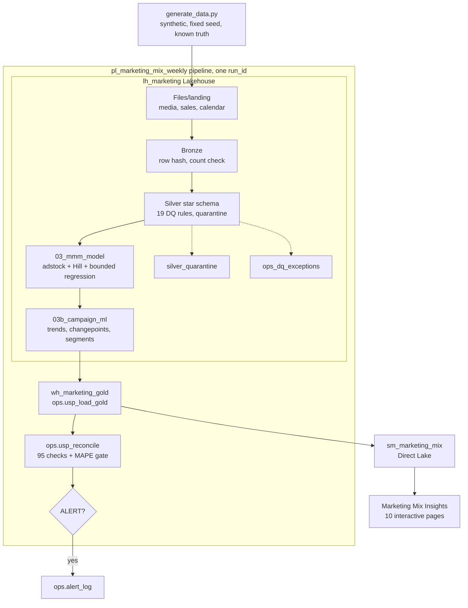

# Marketing mix model on Microsoft Fabric

An end-to-end marketing mix model (MMM) on Microsoft Fabric: raw daily media and sales data land in a
Lakehouse, flow through Bronze and Silver with data-quality controls, a Spark notebook fits the model, a
Warehouse serves Gold, and a Direct Lake semantic model drives a 10-page interactive Power BI report.
Everything is created through the OneLake, Fabric and Power BI REST APIs, so the stack rebuilds from this repo.



| Overview | Campaign Insights (ML) |
|---|---|
|  |  |
| **Platform and Funnel KPIs** | **Budget Optimizer (+30% budget)** |
|  |  |

## What it solves

Marketing teams, media agencies and adtech platforms keep asking the same four questions, and platform
dashboards cannot answer them, because every platform reports its own attributed revenue.

| Question | Why it is hard | What this project does |
|---|---|---|
| Which channels really drive revenue? | Platform attribution overlaps and over-claims, and TV and OOH have no clicks to attribute. | A marketing mix model measures incremental revenue per channel from aggregate spend and sales, and shows it next to platform-reported ROAS. |
| Where should the next dollar go? | Average ROAS hides diminishing returns. | Response curves and a budget optimizer move spend to the highest marginal return, from -30% to +30% budget. |
| Which campaigns are breaking, and why? | Hundreds of noisy KPI lines, so random wobble looks like a trend. | Campaign ML flags only statistically robust trends and step changes, and writes the evidence for each one. |
| Can anyone trust the numbers? | Spend passes through many systems before it reaches a report. | 19 data-quality rules, a quarantine table and 95 reconciliation checks from source file to report on every run. |

## Value for media and adtech teams

- **Measurement that survives signal loss.** The model needs only aggregate spend and sales, with no cookies,
  device IDs or user-level tracking, and it treats walled gardens, programmatic and offline media the same way.
- **Incremental vs attributed, side by side.** In this dataset platform attribution gives Paid Search a ROAS of
  3.94 against 2.99 incremental, Social 1.44 against 2.27, and TV 0.03 against 1.49. A budget set on platform
  numbers alone would overfund Search and starve Social and TV.
- **Budget reallocation with a number on it.** The same total budget, reallocated by marginal return, gives
  +6.4% modelled media-driven revenue. A 30% larger budget gives +28%.
- **Diagnostics a trader or ad ops team can act on.** Each flagged campaign gets a reason, an action and the
  statistics behind it:

  | Signal in the data | What it usually means | Suggested action |
  |---|---|---|
  | CPM rising while CTR and CVR hold | Auction pressure, or a bid or audience change | Reduce, review bids |
  | Clicks arrive but conversions lag channel peers | Low-quality inventory or placements | Reduce, review supply |
  | CVR falls as spend rises | Audience saturation, too much frequency | Reduce |
  | CTR declining while CVR holds | Creative fatigue | Refresh creative |
  | CVR drops in a single week and stays down | Landing page, tracking or offer change | Investigate |
  | CPA well below the channel median on a small spend share | Underfunded winner | Scale |

- **Audit trail for client reporting and billing.** Spend reconciles at campaign and platform grain across
  every layer, bad rows are quarantined and alerted instead of silently dropped, and one `run_id` traces a
  report number back to its source file.
- **Repeatable per client.** The whole stack deploys through REST APIs from this repo, so a new workspace
  for a new brand or client is a script run, not a rebuild by hand.

The data is synthetic with a known ground truth, so the figures above show that the method recovers the truth
(see [Model](#model) and [Campaign ML](#campaign-ml)); they are not results from a real advertiser. On real
data, calibrate the model with geo-holdout experiments before trusting channel ROI.

## Pipeline flow



## Data

Synthetic, because no real MMM dataset was available; `scripts/generate_data.py` (seed 20261108) writes
3 years (156 weeks) of daily data for 5 regions, 6 channels (TV, OOH, Paid Search, Social, Display, Email)
and 3 products, with known adstock, saturation and ROI per channel saved in `data/ground_truth.json`.
Regional campaign variation and four geo-holdout tests (a channel switched off in one region for 8 weeks)
give the model the variation it needs to separate always-on channels from baseline demand.

| File | Rows | Content |
|---|---|---|
| media_spend.csv | 152,880 | date x region x campaign (28 campaigns on 15 platforms): spend, impressions, clicks, conversions, video views, platform-attributed revenue |
| campaigns.csv | 28 | campaign master: platform, channel, objective |
| sales.csv | 16,380 | date x region x product: revenue, units, average price |
| calendar.csv | 5,460 | date x region: holiday, promotion flag, competitor index |

Platforms: TV (Linear TV, Connected TV), OOH (Billboards, Transit, Digital OOH), Paid Search (Google Ads,
Microsoft Ads), Social (Meta, TikTok, LinkedIn, YouTube), Display (The Trade Desk, DV360, Amazon DSP), Email
(Klaviyo). Splitting channels into platforms and campaigns keeps every channel's daily spend exactly as before,
so the MMM results are unchanged. Ten campaigns carry planted issues (creative fatigue, cost inflation,
diminishing returns, low-quality inventory, underfunded winners, a step up after a new creative, a step down
after a landing page change), recorded in `data/campaign_truth.json`, which only the evaluation step reads.

## Model

`scripts/mmm_core.py` (included verbatim into the Fabric notebook and testable locally with
`scripts/test_mmm_local.py`): geometric adstock, Hill saturation, region-size normalisation, trend,
Fourier seasonality, holiday, promotion, competitor and price controls, non-negative media coefficients
(`scipy.optimize.lsq_linear`), coordinate grid search per channel, last 12 weeks held out.

| Check | Result |
|---|---|
| Holdout MAPE (12 unseen weeks) | 0.63% |
| Training R2 | 0.993 |
| Baseline + channels = predicted, every region-week | exact (max gap 0) |
| Total media contribution vs truth | 101.2M vs 106.5M |
| ROI rank order vs truth | correct except Display and OOH (5th and 6th) swapped |

| Channel | Modelled ROI | True ROI | Error |
|---|---|---|---|
| Email | 3.84 | 4.5 | -15% |
| Paid Search | 2.99 | 3.2 | -6% |
| Social | 2.27 | 2.4 | -5% |
| TV | 1.49 | 1.6 | -7% |
| Display | 1.13 | 0.9 | +26% |
| OOH | 1.09 | 1.1 | -1% |

Display is overstated and Email understated; both are reported as found, not tuned away. Display still has
the lowest marginal ROI (0.50), so the optimizer cuts it first, which matches the true economics.

## Campaign ML

`scripts/ml_core.py` (included into `03b_campaign_ml`, tested with `scripts/test_ml_local.py`). The MMM measures
channels, so campaigns are ranked within their channel on platform-reported KPIs only; the cross-channel budget
comes from the MMM optimizer.

| Step | Method |
|---|---|
| Trends | Theil-Sen slope + Kendall tau per campaign x KPI (CTR, CVR, CPM, CPA), Benjamini-Hochberg FDR 5%, minimum 20% change |
| Changepoints | Single mean-shift split with BIC penalty, 10-week minimum segments, 30% minimum shift, flat on both sides (step, not trend) |
| Peer benchmark | CTR, CVR, CPA vs the channel median; spend vs CVR Spearman correlation for saturation |
| Segments | KMeans on recent CPA, CTR, CVR vs channel and CTR/CPA trends, k chosen by silhouette, names from centroids |
| Recommendations | Scale, Hold, Reduce, Refresh creative, Investigate, with budget shift and evidence built only from computed statistics |

| Check | Result |
|---|---|
| Planted issues detected with the right reason | 10/10 |
| False alarms on 13 healthy click-tracked campaigns | 0 |
| Campaign plan per channel = MMM optimizer ratio | exact for all 6 channels |

Example evidence: "CVR stepped from 0.85% to 0.32% (-63%) in the week of 2024-12-02 and stayed flat on both
sides; a sudden step points to a landing page, tracking or offer change, not gradual fatigue."

## Report pages

| Page | Highlights |
|---|---|
| Overview | KPI cards, revenue vs spend combo, spend mix donut, regional trend area, ROAS by channel, year/region/channel slicers |
| Sales Decomposition | Stacked area of baseline + channels over time, waterfall, 100% contribution mix by year |
| Channel ROI | ROI vs marginal ROI, spend vs contribution bubbles, spend share vs contribution share, treemap |
| Platform and Funnel KPIs | Impressions, clicks, conversions, CTR, CVR, CPC, CPA, CPM cards; platform scorecard; CPA by platform; platform-reported vs MMM ROAS |
| Campaign Insights (ML) | Flagged and scale counts, segment scatter, deteriorating campaign trends, recommendations with evidence, detection recall |
| Response Curves | Diminishing-returns curves 0x to 2x spend, carryover and saturation table |
| Budget Optimizer | Scenario slicer -30% to +30%: optimal spend, contribution, uplift, current vs optimal by channel |
| Regional Trends | 4-week average revenue lines, YoY by region, region x channel ROAS heatmap |
| Model Fit and Accuracy | Actual vs predicted, holdout MAPE, recovered vs true ROI |
| Data Quality and Controls | Runs, checks, pass rate, exceptions, alerts, run log |

Each channel keeps one colour on every page (TV purple, OOH pink, Search cyan, Social green, Display amber,
Email orange). Screenshots are in `screenshots/`.

## Controls

One framework across every layer: shared `run_id`, row hashes, `ops_run_log`, Silver data-quality
rules with `silver_quarantine` and `ops_dq_exceptions`, Warehouse `ops` schema (`pipeline_run_log`,
`recon_results`, `dq_exceptions`, `alert_log`), `ops.usp_reconcile` (source -> Bronze -> Silver -> Gold,
decomposition closure, model actuals = Gold revenue, holdout MAPE gate at 10%), `ops.usp_trace_week` for
root cause analysis. Bad data and mismatches alert; only infrastructure errors fail the pipeline.

## Rebuild

```bash
az login --tenant <your-tenant> --allow-no-subscriptions
ALERT_RECIPIENT=you@example.com python scripts/setup_fabric.py   # workspace, Lakehouse, Warehouse -> config.json
python scripts/generate_data.py
python scripts/upload_landing.py
sqlcmd -S <warehouse_server> -d wh_marketing_gold --authentication-method ActiveDirectoryAzCli -i sql/01_ops_and_gold.sql
for n in 01_bronze 02_silver 03_mmm_model 03b_campaign_ml 04_sync_sql_endpoint 05_gold_reconcile; do python scripts/fabric_nb.py $n notebooks/$n.py --deploy-only; done
python scripts/build_pipeline.py --run
python scripts/build_model.py
python scripts/build_report.py
```

All Fabric IDs and the alert recipient live in `config.json`, written by `setup_fabric.py` and kept out of git
(`config.example.json` shows the shape); notebooks use `{{key}}` placeholders filled at deploy time.

## License

MIT, see [LICENSE](LICENSE). The data is synthetic; no real customer or company data is included. See [RUNBOOK.md](RUNBOOK.md) for phases and Done-when checks.
